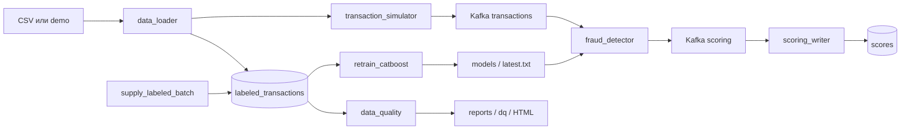

# Антифрод: переобучение в Airflow

Основа — [код семинара 7](https://github.com/NikitaMalykhin/mlops_realtime_fraud_detector_airflow), commit `468e2bd`. Сохранены структура `pipeline/`, TaskFlow DAG, Kafka-контракт, CatBoost, PostgreSQL и обновление модели через `latest.txt`.

Добавлены собственные признаки, проверка качества перед публикацией, отдельный DQ DAG с HTML, журнал обработки месяцев и тесты повторных запусков.



## Запуск

Нужны Docker с Compose v2 и около 6 ГБ памяти для контейнеров. Python на компьютере не требуется.

```bash
git clone https://github.com/mvsamorodova/mlops-fraud-airflow.git
cd mlops-fraud-airflow
cp .env.example .env
docker compose up -d --build --wait --wait-timeout 600
docker compose ps -a
```

Первый запуск собирает образы, загружает данные и обучает стартовую модель на CPU. `data_loader` и `kafka-setup` должны завершиться с `Exited (0)`. Остальные сервисы продолжают работать.

| Сервис | Адрес |
|---|---|
| Airflow | http://localhost:8081 — `admin` / `admin` |
| Kafka UI | http://localhost:8080 |
| Последний DQ-отчёт | http://localhost:8082/dq/latest.html |

Это локальный учебный стенд; порты привязаны к localhost. До первого запуска DQ ссылка на отчёт возвращает 404.

## Данные

По умолчанию `DATA_SOURCE=demo`: генератор с `seed=42` создаёт 12 000 искусственных размеченных транзакций за январь–июнь 2023 года. Они позволяют проверить весь проект без скачивания CSV. Это демонстрационные данные, а не выгрузка Kaggle; метрики на них не характеризуют реальный антифрод.

Для данных занятия 7 скачайте `train.csv` из материалов практики либо [соревнования Kaggle](https://www.kaggle.com/competitions/teta-ml-1-2025/data). Если нужен доступ, используйте [приглашение курса](https://www.kaggle.com/t/1918f3f6435300327d38d6c596f97394).

1. Положите файл в `data/train.csv`.
2. Установите `DATA_SOURCE=csv` в `.env`.
3. Запустите проект с чистой витриной, если до этого использовали demo; команды сброса приведены ниже.

Поддерживаются названия семинара и стандартные алиасы Fraud Detection: `amt` → `amount`, `is_fraud` → `target`, `trans_date_trans_time` → `transaction_time` и другие из `pipeline/data.py`. Обязательные поля перечислены в `pipeline/db.py`. При отсутствии `transaction_id` он создаётся из номера строки CSV. Нужны минимум три последовательных месяца, по 100 строк и оба класса в каждом. CSV и runtime-артефакты исключены из Git.

## DAG

Все DAG запускаются каждые 5 минут, `catchup=False`, `max_active_runs=1`. Ручной запуск: открыть DAG в Airflow и нажать Trigger DAG. Убедитесь, что переключатель DAG включён.

### `supply_labeled_batch`

```text
sample_next_month → append_labeled_batch → prune_old_months
```

Из витрины выбирается до 10 000 строк. Время переносится в следующий месяц после максимального месяца витрины; день 31 обрезается до последнего дня целевого месяца. Строки получают новые идентификаторы, метки сохраняются. Хранятся последние 36 календарных месяцев, включая самый новый.

Выборка детерминирована относительно месяца. Журнал `run_requests` закрепляет месяц за запуском, а `pipeline_runs` фиксирует его состояние. Вставка и отметка об успехе выполняются одной транзакцией. Повтор задачи или очистка задач того же DAG run не добавляет месяц второй раз. Незавершённый месяц подхватывает следующий запуск.

Поставка приостанавливается, если очистка затронула бы ещё не обработанное окно обучения. История не теряется при отставании обучения. Пропуск в этом случае ожидаем и отмечается `skipped`.

### `retrain_catboost`

```text
extract_month_batch → slide_training_window → time_train_test_split
→ preprocess_dataset → fit_catboost → evaluate_model → publish_model
```

Окно — три месяца: два ранних для train, самый свежий для test. При старте окно январь–март; первый DAG обучается на феврале–марте и проверяется на апреле. Для CSV начальная дата определяется по данным. Следующее окно — март–май. Число месяцев фиксировано, случайного split нет. Если следующий месяц ещё не поставлен, DAG пропускает обработку.

Test не используется в обучении, подборе параметров или early stopping. CatBoost: 100 итераций, глубина 6, `random_seed=42`, CPU, два потока.

Собственный препроцессинг в `fraud_detector/src/preprocessing.py`:

- `log1p` суммы и населения;
- циклические признаки часа и дня недели;
- ночное время и выходной;
- индикаторы пропущенных числовых значений;
- категории с заполнением `unknown`;
- расстояние haversine из семинара.

Имена, адрес, идентификатор транзакции и целевая переменная не входят в признаки. Один модуль используется в обучении и скоринге; преобразования не требуют fit.

### Проверка модели перед публикацией

Кандидат и текущая production-модель оцениваются на одном test-месяце. Основная метрика — `average_precision` (AP), подходящая для несбалансированного класса. Публикация разрешена при `AP_candidate >= AP_production`; равенство допускается. Дополнительно сохраняются ROC-AUC, F1, precision и recall при пороге `score > 0.5`; они диагностические и не определяют публикацию.

Если AP ухудшилась, кандидат остаётся в каталоге для аудита, а `latest.txt` не меняется. Отказ по качеству — штатное успешное завершение DAG. При отсутствии обоих классов в test или пересечении test с периодом обучения production публикация запрещена ошибкой.

`training_state` отслеживает обработанные месяцы, `latest.txt` — активную модель. Указатель месяца обновляется только после сохранения бинарника кандидата и метрик, в том числе при отклонении кандидата. Это позволяет перейти к следующему месяцу без публикации плохой модели.

Каждый месяц имеет отдельные snapshot-файлы и версию `vYYYYMM`. Файлы сохраняются через временный файл и `os.replace`. Публикация и фиксация месяца защищены блокировкой PostgreSQL. Если процесс упал после записи `latest.txt`, повтор завершает тот же месяц. Повтор уже завершённого месяца ничего не меняет и не откатывает активную модель.

Скоринг читает `latest.txt` перед обработкой сообщения. Новая модель загружается без перезапуска контейнера. Если загрузка нового файла не удалась, используется предыдущая модель; в результат записывается её фактическая версия.

### `data_quality`

```text
extract_quality_snapshot → check_dataset → render_report → enforce_quality
```

Проверяется snapshot всей размеченной витрины. Все правила обязательны:

| Правило | Требование |
|---|---|
| Схема | Все обязательные колонки присутствуют |
| Объём | Витрина не пуста |
| Пропуски | ID, время, сумма и target заполнены |
| Уникальность | `transaction_id` не повторяется |
| Сумма | Конечное число, `amount >= 0` |
| Метка | Только `0` или `1` |
| Даты | Корректные значения времени |
| Координаты | Широта от −90 до 90, долгота от −180 до 180 |
| Месяцы | Последовательные, не меньше размера окна |
| Месячные срезы | Не менее 100 строк и оба класса в каждом месяце |

HTML и JSON сохраняются в `artifacts/reports/dq/`, рядом с `artifacts/models/`. Отчёт содержит результаты и число нарушений. HTML записывается до завершающей задачи: при FAIL он остаётся доступен, а DAG завершается ошибкой. Повтор того же запуска использует тот же snapshot. Новый Trigger проверяет свежие данные.

## Проверка результата

1. В Airflow запустите `supply_labeled_batch`, дождитесь Success.
2. Запустите `retrain_catboost`, проверьте задачи и артефакты.
3. Запустите `data_quality`, откройте HTML-отчёт.
4. Посмотрите принятую версию и результаты скоринга:

```bash
docker compose exec fraud_detector cat /models/latest.txt
docker compose exec airflow ls -l /opt/airflow/models
docker compose exec postgres psql -U fraud_user -d fraud_db -c \
  "SELECT transaction_id,score,fraud_flag,model_version FROM scores ORDER BY id DESC LIMIT 10;"
docker compose exec postgres psql -U fraud_user -d fraud_db -c \
  "SELECT * FROM training_state;"
```

В `artifacts/models/my_catboost_vYYYYMM.metrics.json` находятся метрики обеих моделей и `accepted`. При `accepted=false` прежняя версия в новых скорах ожидаема. На demo первый кандидат (апрель) проходит проверку; майский отклоняется при параметрах по умолчанию.

Контракт сохранён: вход Kafka `transactions` — объект `transaction_id` и `data`; выход `scoring` — список объектов `transaction_id`, `score`, `fraud_flag`, `model_version`. Таблица результатов — `scores`. Kafka offsets подтверждаются после отправки результата или записи в БД. Повторная доставка в writer дедуплицируется по ID.

## Тесты

```bash
docker compose run --rm tests
docker compose exec airflow python /opt/airflow/scripts/check_dags.py
```

Тесты проверяют признаки, временной split, границы календарных месяцев, DQ с отрицательными примерами, hot reload, повтор поставки, восстановление после сбоя публикации и отклонение кандидата. Тесты БД создают отдельную временную базу и удаляют её после выполнения.

[GitHub Actions](https://github.com/mvsamorodova/mlops-fraud-airflow/actions) дополнительно поднимает Compose с нуля, запускает все DAG через REST API, проверяет новые скоры и отсутствие перезапуска scorer, затем проверяет плановые запуски. На время CI расписание сокращено до минуты. Логи, метрики, HTML и `smoke.json` доступны в артефакте `verification`.

## Настройки

| Переменная | По умолчанию |
|---|---|
| `DATA_SOURCE` | `demo`; для файла — `csv` |
| `WINDOW_MONTHS` | `3` |
| `HISTORY_MONTHS` | `36` |
| `SAMPLE_SIZE` | `10000` |
| `MODEL_ITERATIONS` | `100` |
| `DAG_SCHEDULE` | `*/5 * * * *` |
| `DAGS_PAUSED` | `false` |

Размер окна и источник данных задавайте до первого запуска; для изменения нужен чистый стенд. `DAG_SCHEDULE=manual` отключает расписание для воспроизводимых тестов.

## Остановка и диагностика

```bash
docker compose logs --tail=100 data_loader airflow fraud_detector scoring_writer
docker compose exec airflow airflow dags list-import-errors
docker compose down
```

`down` сохраняет состояние. Для полного сброса **всех данных и моделей этого проекта**:

```bash
docker compose down -v
docker compose run --rm --no-deps --user root -v ./artifacts:/artifacts tests \
  python -c "from pathlib import Path; import shutil; [shutil.rmtree(p) for p in [Path('/artifacts/models'), Path('/artifacts/reports')] if p.exists()]"
docker compose up -d --build --wait --wait-timeout 600
```
