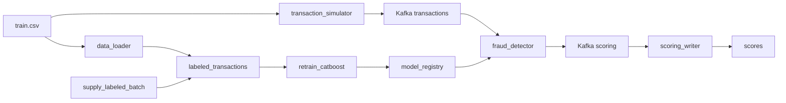

# Антифрод: поток транзакций, скоринг и переобучение

Учебный проект обнаружения мошеннических транзакций. Kafka несёт непрерывный поток событий, CatBoost скорит их текущей моделью, а Airflow по расписанию дописывает размеченные месяцы и переобучает модель.

Датасет можно найти [здесь](https://www.kaggle.com/competitions/teta-ml-1-2025/data). В этом занятии используется файл `train.csv` из каталога практики занятия 07. Путь задаётся переменной `TRAIN_DATA_CSV`.

---

## Архитектура



| Сервис | Описание |
|--------|----------|
| **Kafka** | Шина сообщений между симулятором потока, скорингом и записью результатов |
| **Zookeeper** | Управление кластером Kafka |
| **Kafka UI** | Просмотр топиков `transactions` и `scoring` |
| **transaction_simulator** | Бесконечно шлёт в `transactions` случайные строки CSV. У каждой новый `transaction_id` и `transaction_time`, равный текущему моменту, формат `YYYY-MM-DD HH:MM` |
| **fraud_detector** | Препроцессинг и инференс CatBoost. Перед каждым сообщением читает `/models/latest.txt` и подхватывает `my_catboost_<версия>.cbm` без перезапуска |
| **scoring_writer** | Читает топик `scoring` и пишет `score`, `fraud_flag` и `model_version` в PostgreSQL |
| **PostgreSQL** | Витрина `labeled_transactions`, состояние окна `training_state` и таблица `scores` |
| **data_loader** | При старте один раз загружает весь CSV в витрину и собирает исходное окно обучения: январь–март 2019 |
| **airflow** | Два DAG каждые 5 минут: поставка нового размеченного месяца и переобучение CatBoost |

Общий том `model_registry` смонтирован в Airflow как `/opt/airflow/models` и в `fraud_detector` как `/models`. Логика задач вынесена в `pipeline/`. Файлы в `dags/` только связывают задачи.

---

## Структура проекта

```
.
├── fraud_detector/           # Онлайн-скоринг
├── transaction_simulator/    # Непрерывная поставка транзакций в Kafka
├── scoring_writer/           # Запись скоров в PostgreSQL
├── data_loader/              # Первичная загрузка размеченной витрины
├── dags/
│   ├── retrain_catboost.py   # DAG переобучения
│   └── supply_labeled_batch.py
├── pipeline/
│   ├── db.py                 # Подключение к витрине и training_state
│   ├── retrain/              # Функции задач переобучения
│   └── supply/               # Функции задач поставки месяца
├── airflow/                  # Образ Airflow с CatBoost
├── docker-compose.yaml
├── .env.example
└── README.md
```

---

## Что происходит после запуска

1. `data_loader` копирует `TRAIN_DATA_CSV` в `labeled_transactions` и сохраняет окно января–марта 2019. Повторный старт без `down -v` витрину не перезаливает.
2. `transaction_simulator` каждые 0.1 секунды отправляет в Kafka случайную транзакцию с текущим временем.
3. `fraud_detector` скорит поток моделью из общего каталога. До первого переобучения версия — `initial`: в каталог копируется модель из образа.
4. `scoring_writer` складывает результат в `scores`, включая `model_version`.
5. DAG `supply_labeled_batch` каждые 5 минут берёт из витрины 100 тысяч случайных строк, переносит их время в следующий календарный месяц и дописывает батч. Наблюдения старше трёх лет относительно самого нового месяца удаляются.
6. DAG `retrain_catboost` каждые 5 минут забирает следующий месяц витрины, начиная с апреля 2019, сдвигает трёхмесячное окно, учит CatBoost и публикует `my_catboost_<timestamp>.cbm`.

Переобучение и поставка идут по разным указателям месяца. `retrain_catboost` читает исторические месяцы с апреля 2019. `supply_labeled_batch` каждый раз создаёт месяц после максимальной даты витрины, первый такой месяц — апрель 2020. Окно обучения ещё долго не доходит до этих батчей, и очистка трёх лет его не затрагивает.

Оба DAG можно запустить вручную в Airflow, не дожидаясь расписания. Если очередного месяца в витрине ещё нет, задачи переобучения помечаются как skipped.

---

## Технологии

- **Python 3.11**
- **ML**: CatBoost, pandas, numpy
- **Kafka**: потоковая обработка данных
- **PostgreSQL**: витрина размеченных данных и результаты скоринга
- **Airflow 2.10**: поставка месячных батчей и переобучение модели
- **Docker / Docker Compose**: оркестрация микросервисов

---

## Как запустить проект

### 1. Клонируйте репозиторий

```bash
git clone https://github.com/NikitaMalykhin/mlops_realtime_fraud_detector_airflow.git
cd mlops_realtime_fraud_detector_airflow
```

### 2. Создайте `.env` файл

```bash
cp .env.example .env
```

В `TRAIN_DATA_CSV` укажите путь к размеченному `train.csv` на вашей машине.

### 3. Запустите контейнеры

```bash
docker compose up --build
```

Нужны [Docker](https://docs.docker.com/engine/install/) и Docker Compose. Первый запуск скачивает образы и загружает витрину, это занимает несколько минут.

## Доступные сервисы

| Сервис | URL |
|--------|-----|
| **Kafka UI** | http://localhost:8080 |
| **Airflow** | http://localhost:8081 (`admin` / `admin`) |
| **PostgreSQL** | `localhost:5432`, база `fraud_db` |

Пользователь и пароль Postgres задаются в `.env` (`fraud_user` / `fraud_pass` в шаблоне).

Посмотреть витрины из контейнера:

```bash
docker compose exec postgres psql -U fraud_user -d fraud_db
```

---

## Таблицы PostgreSQL

Таблица `scores`:

| Поле | Тип | Описание |
|------|-----|----------|
| id | SERIAL | Уникальный ID |
| transaction_id | TEXT | Идентификатор транзакции |
| score | FLOAT | Вероятность мошенничества, порог 0.5 |
| fraud_flag | INT | 1, если score больше 0.5, иначе 0 |
| model_version | TEXT | Версия CatBoost, которая посчитала скор |
| created_at | TIMESTAMP | Время записи |

`labeled_transactions` — витрина размеченных транзакций. `training_state` хранит границы трёхмесячного окна обучения и месяц следующего батча.

Последние скоры:

```sql
SELECT transaction_id, score, fraud_flag, model_version, created_at
FROM scores
ORDER BY created_at DESC
LIMIT 20;
```

Модели, которые опубликовал DAG:

```bash
docker compose exec airflow ls -la /opt/airflow/models
```

---

## Как смотреть демонстрацию

1. В Kafka UI топик `transactions` пополняется каждые 0.1 секунды, топик `scoring` — ответами модели.
2. В Airflow откройте `supply_labeled_batch` и `retrain_catboost`. Кнопка Trigger запускает прогон сразу.
3. После публикации модели новые сообщения в `scores` получают свежий `model_version`.

### Очистка

`docker compose down -v` удаляет контейнеры вместе с витриной, окном обучения, реестром моделей и состоянием Airflow. Следующий запуск снова загрузит CSV.
